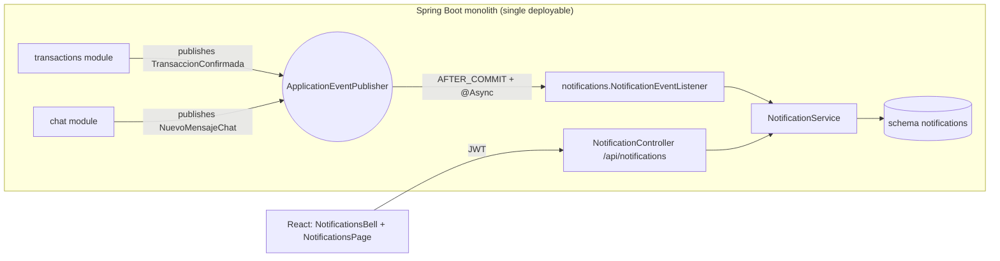
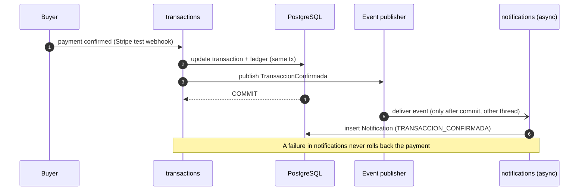

# Epic 5 - Notifications in the modular monolith

Week 06 - Huila Agricultural Marketplace (Phase 1, modular monolith).

## 1. Goal

Close the last epic of the Phase 1 backlog: a user receives a notification when one of their
transactions is confirmed or when they get a new chat message, and can read them in the web app.

## 2. Design decision: notifications is a pure consumer

`notifications` exposes **no** `XModuleApi`. No other module calls it. It only reacts to domain
events that `transactions` and `chat` already published. This is the in-process version of the
future **worker** that will consume the same events from RabbitMQ.

## 3. Event flow (why `AFTER_COMMIT` + `@Async`)

| Choice | Reason |
|---|---|
| `@TransactionalEventListener(AFTER_COMMIT)` | No notification for a transaction that was rolled back |
| `@Async("notificationsExecutor")` | The publisher does not wait for the notification; fault isolation |
| No public API module | Matches the target: Notifications is a worker, not a domain service |

## 4. API for the signed-in user

| Method | Path | Effect |
|---|---|---|
| GET | `/api/notifications` | List my notifications (newest first) |
| PUT | `/api/notifications/{id}/read` | Mark one as read |
| PUT | `/api/notifications/read-all` | Mark all as read |

Types: `TRANSACCION_CONFIRMADA`, `NUEVO_MENSAJE_CHAT`.

## 5. Backlog state after this week

## 6. Known limits (input for the distributed phase)

- In-memory async events are lost if the process stops between commit and delivery: the
  distributed version needs RabbitMQ and a transactional outbox.
- The monolith is published in `market-agri-docs/12-ux-ui/MVP/` as the functional and visual
  reference; the services will re-implement its behaviour against the API contract.
