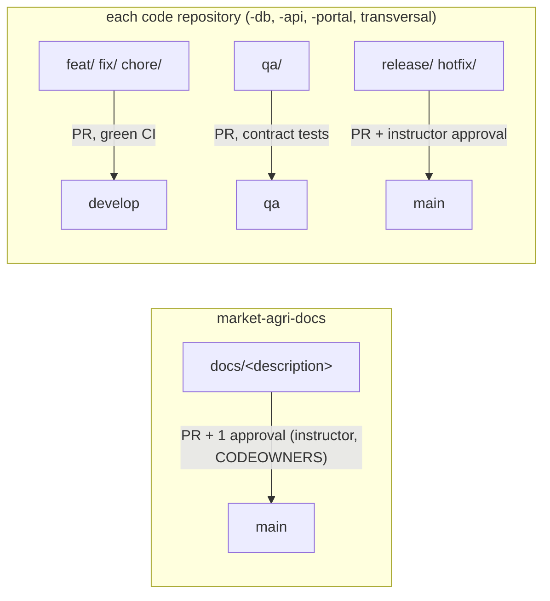
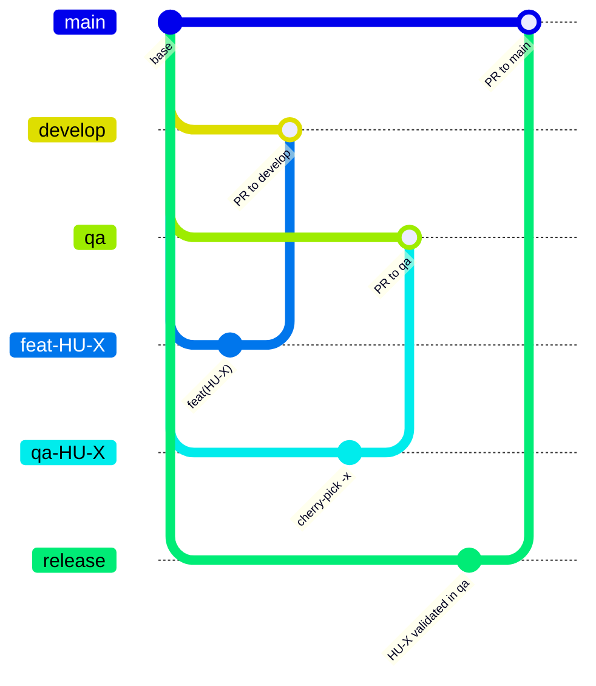

# Branching policy adopted by the team

Week 07 - Huila Agricultural Marketplace. Source: `market-agri-docs/00-governance/branching-policy.md`
(course rule, merged in PR #4).

## 1. The single rule

> No permanent branch ever accepts a direct commit. You enter through a child branch, and you
> leave through a Pull Request.

## 2. Docs repository vs code repositories

## 3. Promotion by re-application, never by merge

There is no `merge develop -> qa` nor `merge qa -> main`. A story moves forward by branching off
the **target** branch and re-applying its commit with `cherry-pick -x`.

Why `-x`: a re-applied commit gets a new SHA, so Git can no longer prove it came from `develop`.
`-x` writes `(cherry picked from commit <sha>)` in the message; that trail is the evidence that
every story passed through each environment.

## 4. Gates per branch

| Branch | Fed by | Gate |
|---|---|---|
| `develop` | `feat/` `fix/` `chore/` | green CI + peer review (team rule) |
| `qa` | `qa/` | contract tests (Pact) + peer review |
| `main` | `release/` `hotfix/` | 1 approval from the instructor + CODEOWNERS + resolved conversations |

## 5. What the team still has to decide (next weeks)

- Exact child branch naming with the sub-task ID (e.g. `feat/HU-AUTH-001-...`).
- Review rule between the two developers on `develop` and `qa`.
- Release cadence (default: one release per MVP).
