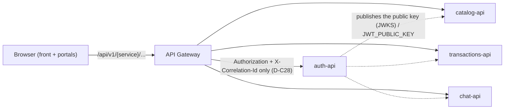
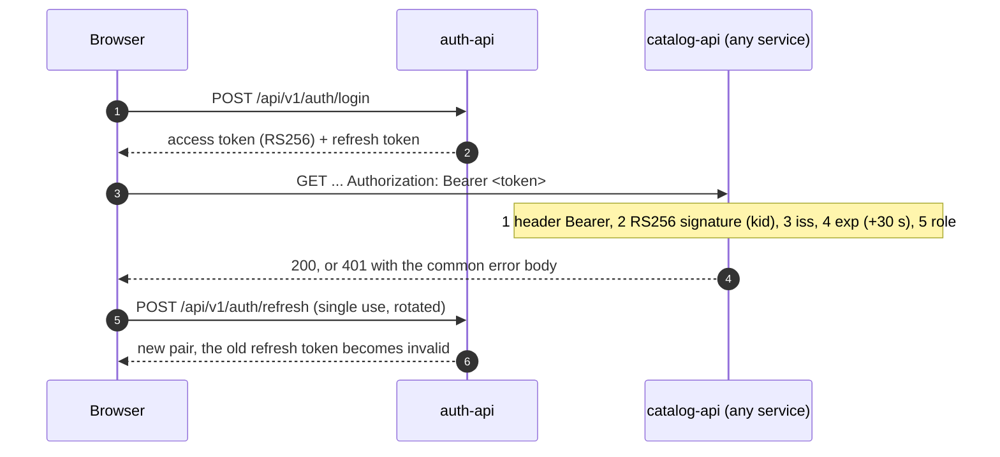
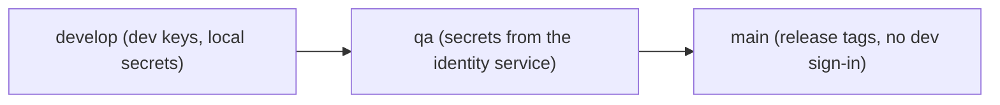
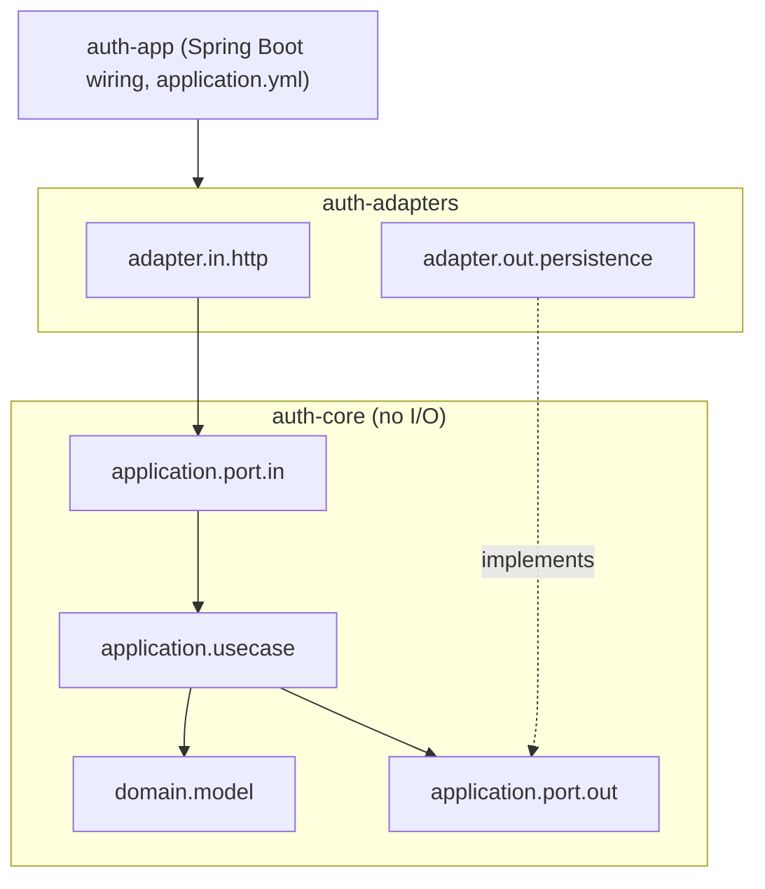

# API contract, auth service contract and auth-api scaffold

Week 08 - Huila Agricultural Marketplace. Sources: `market-agri-docs/07-api/api-contract.md`,
`07-api/contracts/openapi/service-auth.yaml`, `10-devops/environments.md`, `market-agri-auth-api`.

## 1. Path of a request

Every request enters through the gateway; services validate the JWT themselves with the public
key, so `auth` is not called on every request.

## 2. Login and local JWT validation (D-C1, D-C2)

## 3. Auth service endpoints (`service-auth.yaml`)

| Method | Path | Purpose |
|---|---|---|
| POST | `/api/v1/auth/register` | Register a producer or buyer (returns the user, not tokens - D-C32) |
| POST | `/api/v1/auth/login` | Get a session |
| POST | `/api/v1/auth/refresh` | Rotate the refresh token |
| POST | `/api/v1/auth/logout` | End the session |
| GET | `/api/v1/auth/jwks` | Public key published for validators |
| GET / PUT | `/api/v1/auth/farm-profile` | Read / fill my farm profile |
| GET | `/api/v1/auth/users/{id}` | Public data of a user |
| POST | `/internal/v1/auth/service-token` | Service token for worker / workflow (D-C27) |
| GET | `/health`, `/health/ready` | Liveness and readiness (D-C20) |

## 4. Selected closed decisions of the contract

| ID | Decision |
|---|---|
| D-C1 | JWT RS256, five local checks, public key by configuration |
| D-C2 | Refresh tokens single use with rotation |
| D-C4 | Routes `/api/v1/{service}/...` |
| D-C21 / D-C22 | One error body, always present; 400 shape, 422 rule, 409 state |
| D-C24 | Pagination `page/limit`; out of range is 400 |
| D-C26 | Spanish messages, English everything else |
| D-C28 | The gateway forwards only `Authorization` and `X-Correlation-Id` |

## 5. Environments (aligned with the instructor)

Each permanent branch is an environment, assembled by `market-agri-infra` from the sibling
repositories on the same branch. Committed files hold only variable names and placeholders
(`.env.example`, `env/.env.<environment>.example`); real values are git-ignored.

## 6. auth-api hexagonal scaffold

Dependencies point inwards: `auth-core` does not know Spring, HTTP or the database, so the
domain can be tested without infrastructure. Delivered with CI (`ci.yml`), `deploy/Dockerfile`,
`deploy/compose.yml`, `.env.example` and a context-load test.
