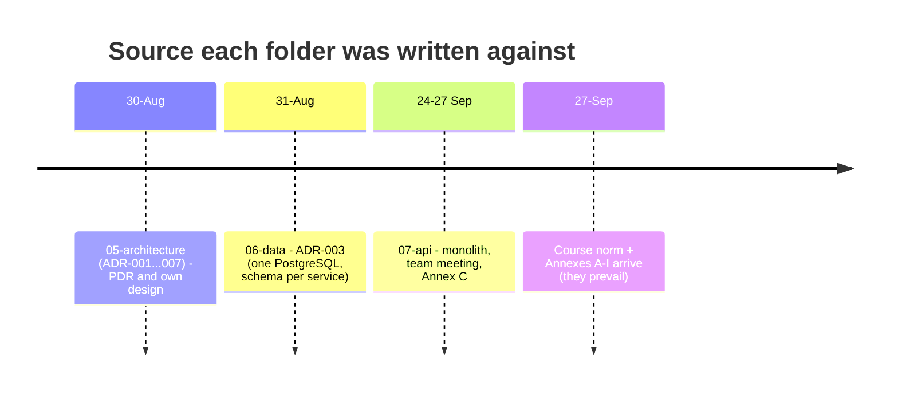
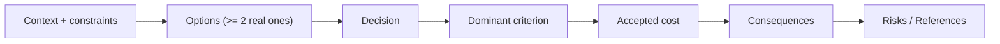
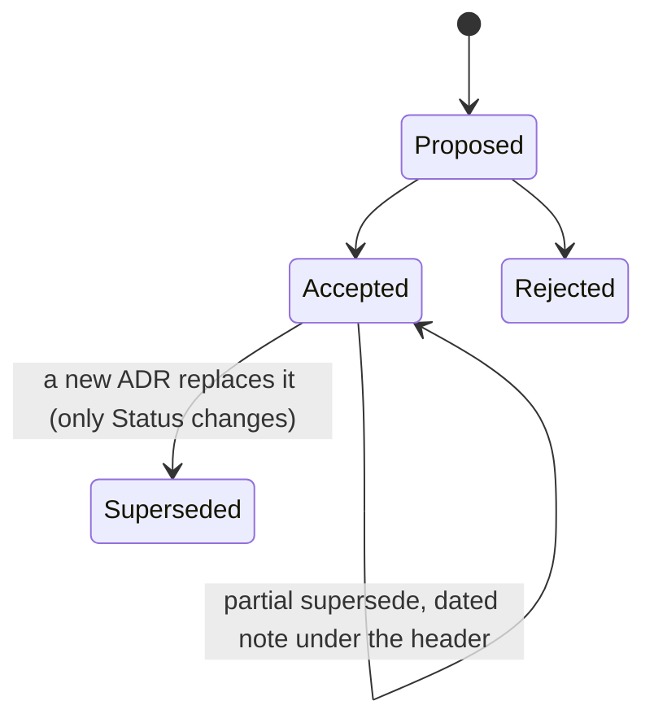
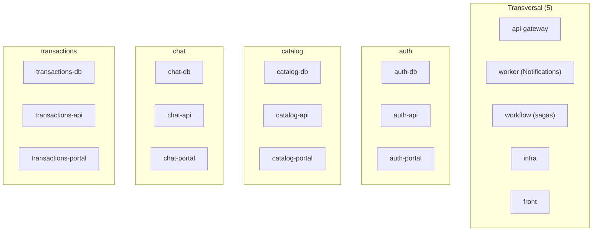
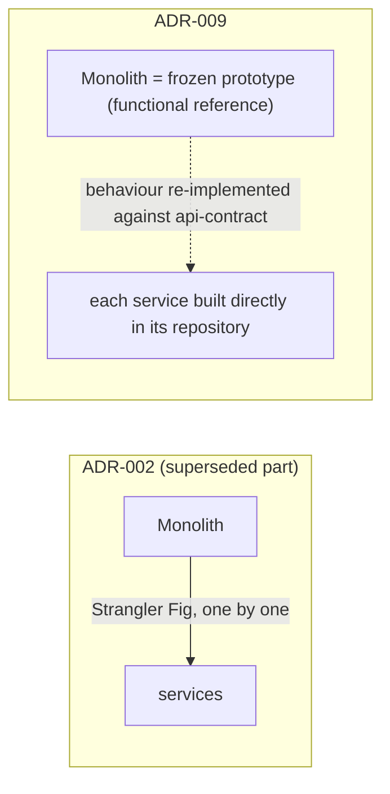

# ADR alignment with the course norm, repository topology and delivery strategy

Week 09 - Huila Agricultural Marketplace. Sources: `market-agri-docs/05-architecture/decisions/`
(README, `_template-adr.md`, ADR-008, ADR-009).

## 1. Why an audit

The documentation folders were written at three different moments, each against a different
source of truth. When the course norm arrived it took precedence over all of them.

Result: several accepted ADRs contradict the norm. The fix is **not** to rewrite them, but to
write new ADRs that supersede them, so the history of why the decision changed is kept.

## 2. ADR structure required by norm 4.2.3

> An ADR without a dominant criterion and an accepted cost is a statement, not a decision.

### Status lifecycle and superseding

## 3. ADR-008 - Repository topology

Norm formula: `Total = 5 + N x (2 + C)`. Real decision: is Notifications a domain or the worker?
It only reacts to events and has no business API, so it is the worker: `N = 4`, `C = 1` (web).

`5 + 4 x (2 + 1) = 17` repositories.

| Option | Repositories | Why not / why |
|---|---|---|
| **A - 4 domains, Notifications = worker** | 17 | Chosen: matches the worker definition of the norm |
| B - 5 domains, Notifications with db/api/portal | 20 | Three more repos to mirror events, for two developers |
| C - Notifications inside another domain | 17 | Mixes responsibilities, breaks one context per domain |

Accepted cost: notifications cannot be listed (no bell, no "mark as read").
Later amendment (ADR-010): `market-agri-infra-mongo` is added -> 18 repositories.

## 4. ADR-009 - Delivery strategy

- Dominant criterion: norm section 3.2 - after the first cut the prototype is not evaluated and
  receives no more work.
- Accepted cost: no complete end-to-end flow until gateway, auth, catalog and infra exist
  together; the domain logic is rewritten, not moved.
- Mitigation: bring up gateway + auth + catalog first.

## 5. Plan produced by the audit (next weeks)

| Order | Work |
|---|---|
| 1 | ADR template + format retrofit (done, PR #11) |
| 2 | Topology and delivery (done, PR #12) |
| 3 | Data isolation and migrations (ADR-010, ADR-011) |
| 4 | Money, transversal state, outbox (ADR-012...014) |
| 5 | Correction PRs in `06-data`, citing each ADR |
