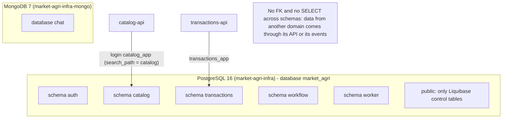
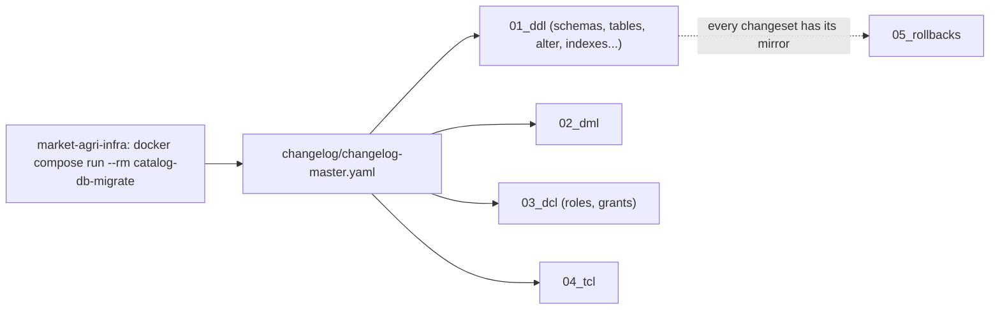
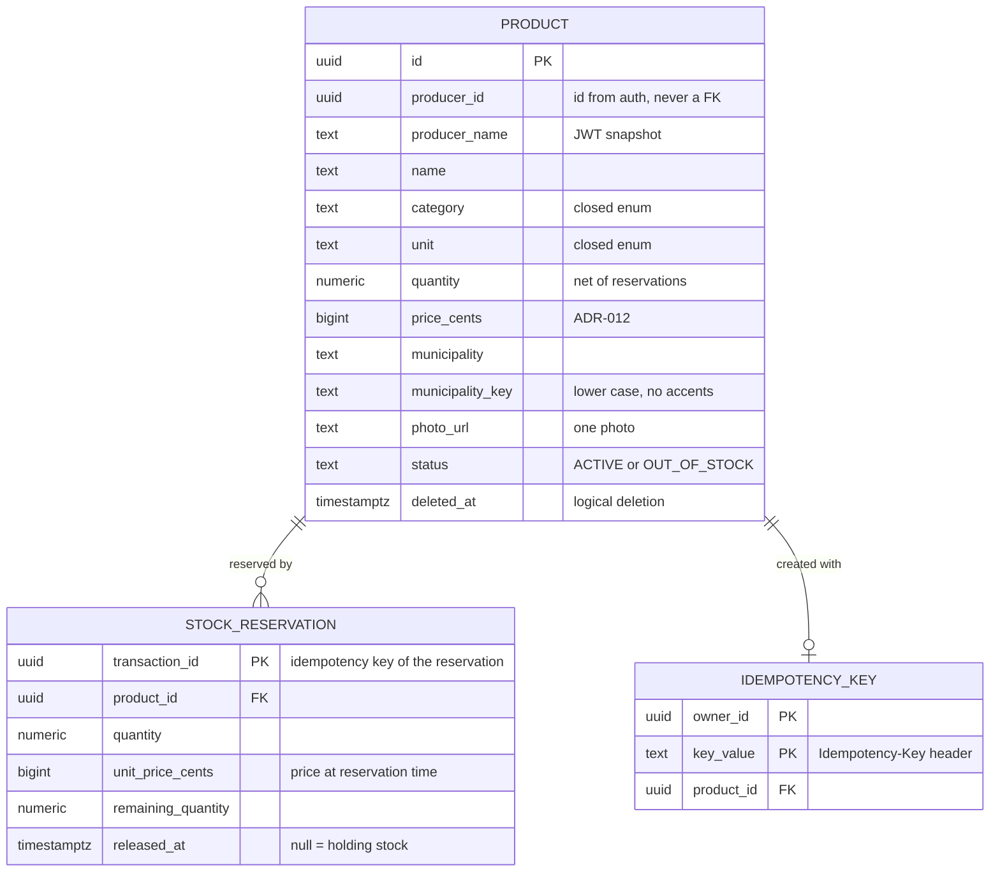
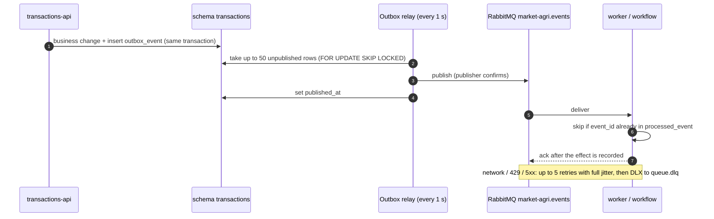
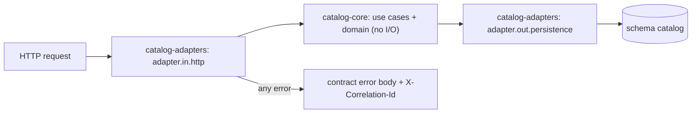
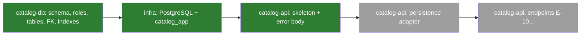

# Data platform: isolation, migrations, events and the first real service (catalog)

Week 10 - Huila Agricultural Marketplace. Sources: `market-agri-docs` ADR-010...ADR-014 and
`06-data`, `market-agri-catalog-db`, `market-agri-infra`, `market-agri-catalog-api`.

## 1. Data isolation (ADR-010)

One instance per engine (per environment), one schema per domain, and the database itself
refuses writes to another domain's schema.

| Element | Rule |
|---|---|
| Login user | `<x>_app`, created by the idempotent infra init script |
| Roles | `<x>_reader`, `<x>_writer` (`NOLOGIN`), privileges only on their schema |
| Migrations | run as administrator; services never connect as administrator |
| Cross-domain | no foreign keys, no reads; data comes through the other domain's API or events |

## 2. Migrations with Liquibase (ADR-011)

An applied changeset is never edited: a fix is a new changeset. Each domain has its own control
table (`databasechangelog_catalog`).

## 3. Catalog model (catalog-db, as merged this week)

Business rules enforced by the database: `ACTIVE` always has stock
(`status <> 'ACTIVE' OR quantity > 0`), price range, closed enums for category and unit, and
`catalog_writer` has no `DELETE` privilege (deletion is logical).

## 4. Event delivery (ADR-013, ADR-014)

Why: without the outbox, a crash between "save" and "publish" loses the event or publishes one
for a change that was rolled back.

## 5. catalog-api skeleton

Delivered: module scaffold, image built from whole modules, server limits and graceful shutdown,
contract error body for every error (500 detail only in logs), correlation id in responses and
logs, with tests for the Annex C checks.

## 6. Sub-task progress at the end of the week

