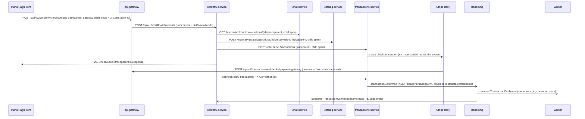

# CP1 - Critical journey and trace map

## Journey chosen: Buyer checkout (HU-TXN-001)

A buyer, from an open chat conversation with a producer, buys a product. The request enters
through `market-agri-api-gateway`, the checkout saga in `market-agri-workflow` orchestrates
`chat`, `catalog` and `transactions`, and the confirmation travels by RabbitMQ to the
notifications `worker`.

Sources in `market-agri-docs`: `07-api/api-contract.md` (E-40, I-05, I-03, I-06, E-43),
`02-domain/domain-events.md` (`TransactionConfirmed`), `05-architecture/overview.md` §3 and
`05-architecture/cross-cutting.md` §3 (correlation).

> Today the team propagates only `X-Correlation-Id` (NFR-050/051). This map adds the W3C
> `traceparent` next to it: `correlation_id` stays the business key of the request, `trace_id`
> links the spans.

## Hop table

| Step | Caller | Receiver | Protocol | Operation | Sync/Async | Data touched |
|---|---|---|---|---|---|---|
| 1 | market-agri-front (container) | api-gateway (NGINX) | REST | `POST /api/v1/workflow/checkouts` (E-40) | sync | none |
| 2 | api-gateway | workflow-service | REST | `POST /api/v1/workflow/checkouts` | sync | `workflow.saga_instance`, `saga_step` |
| 3 | workflow-service | chat-service | REST | `GET /internal/v1/chat/conversations/{id}` (I-05) | sync | MongoDB `chat.conversations` (read) |
| 4 | workflow-service | catalog-service | REST | `POST /internal/v1/catalog/products/{id}/reservations` (I-03) | sync | `catalog.product`, `catalog.stock_reservation` |
| 5 | workflow-service | transactions-service | REST | `POST /internal/v1/transactions` (I-06) | sync | `transactions.payment_transaction`, `idempotency_key` |
| 6 | transactions-service | Stripe Checkout (test) | REST | create checkout session | sync | none |
| 7 | Stripe | api-gateway -> transactions-service | REST | `POST /api/v1/transactions/webhooks/payment-gateway` (E-43) | async (new request) | `payment_transaction`, `ledger_entry`, `outbox_event` |
| 8 | transactions outbox relay | RabbitMQ | AMQP | publish `TransactionConfirmed` (`transactions.transaction-confirmed`) | async | queue |
| 9 | worker (notifications) | RabbitMQ | AMQP | consume `TransactionConfirmed` -> `SendNotification` x2 | async | `worker.notification`, `processed_event` |
| 10 | workflow-service | RabbitMQ | AMQP | consume `TransactionConfirmed` -> end saga | async | `workflow.saga_instance` |

Step 7 is a new request from Stripe, so it starts a **new trace**. The link back to the checkout
is the `transactionId` (Stripe metadata) and the `correlation_id` stored on the transaction.

## Sequence diagram

## Span tree

Trace A - checkout (one `trace_id`):

- `POST /api/v1/workflow/checkouts` - api-gateway (root span)
  - `POST /api/v1/workflow/checkouts` - workflow-service (server span)
    - `saga.checkout.start` - workflow-service (internal, writes `saga_instance`)
      - `GET /internal/v1/chat/conversations/{id}` - client span -> chat-service server span
      - `POST /internal/v1/catalog/products/{id}/reservations` - client span -> catalog-service server span
        - `INSERT catalog.stock_reservation` - catalog-service (db span)
      - `POST /internal/v1/transactions` - client span -> transactions-service server span
        - `stripe.checkout.session.create` - transactions-service (client span)

Trace B - payment confirmation (new `trace_id`, linked to trace A by `transactionId`):

- `POST /api/v1/transactions/webhooks/payment-gateway` - api-gateway (root span)
  - `webhook.verify_and_confirm` - transactions-service (writes `ledger_entry`, `outbox_event`)
  - `outbox.publish TransactionConfirmed` - transactions relay (producer span) **<- crosses the async border**
    - `consume TransactionConfirmed` - worker (consumer span, same `trace_id`, parent = producer span)
      - `SendNotification` x2 - worker (buyer and producer)
    - `consume TransactionConfirmed` - workflow-service (consumer span, same `trace_id`)
