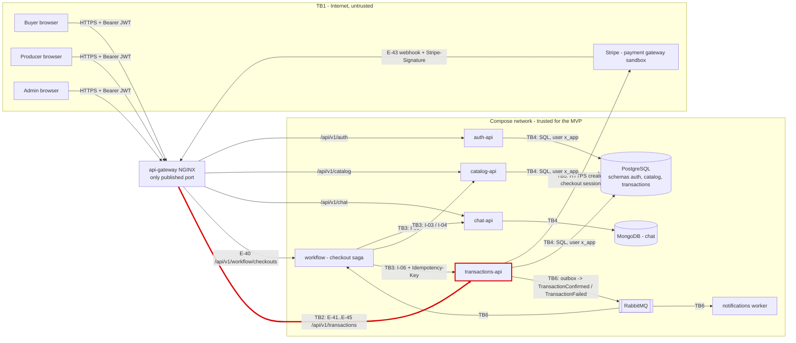

# CP1 - Attack surface map of market-agri

Sources: `market-agri-docs` `05-architecture/overview.md`, `05-architecture/security-threat-model.md`,
`07-api/api-contract.md`, `03-product/PDR.md`.

## 1. Data flow and trust boundaries

My boundary is **TB2: api-gateway -> transactions-api** (red).

| Id | Boundary | Why data changes trust level |
|---|---|---|
| TB1 | Internet -> api-gateway | Browsers and Stripe are outside our control |
| **TB2** | **api-gateway -> transactions-api** | **The gateway only checks that the `Authorization` header exists (overview.md, AuthN row); transactions-api must validate the JWT, the role and the participant itself** |
| TB3 | workflow -> chat / catalog / transactions (`/internal/**`) | Service-to-service calls with a `SERVICE` token (I-01) |
| TB4 | Service -> its datastore | Each service has its own schema and `<x>_app` user (ADR-010) |
| TB5 | transactions-api -> Stripe | Third-party API with secret keys |
| TB6 | Service -> RabbitMQ -> consumers | Events can be replayed or duplicated (ADR-013, ADR-014) |

## 2. Asset inventory

| Asset | Where it lives | Classification |
|---|---|---|
| `payment_transaction` rows (amount in pesos, status `PENDING/CONFIRMED/FAILED`) | `transactions` schema, `TransactionView` in E-41/E-42 | Confidential |
| `ledger_entry` rows (one per confirmed transaction) | `transactions` schema, E-44/E-45 admin views | Restricted |
| Stripe secret key and webhook signing secret | transactions-api environment variables | Restricted |
| Access token (RS256 JWT with `sub` and `role`) | Browser, `Authorization` header crossing TB1 and TB2 | Confidential |
| Buyer and producer ids of a purchase (`buyerId`, `producerId`) | `payment_transaction`, admin filters of E-44 | Confidential |
| Product price shown to buyers | `catalog` schema, catalog-api | Public |
| `TransactionConfirmed` event payload | Outbox table and RabbitMQ queue | Internal |

## 3. Entry points of TB2 (api-gateway -> transactions-api)

| Entry point | Who calls it | How it authenticates today |
|---|---|---|
| `GET /api/v1/transactions/{id}` (E-41) | Buyer or producer of that transaction | JWT `BUYER`/`PRODUCER` + participant check (`403 NOT_A_PARTICIPANT`) |
| `GET /api/v1/transactions/mine` (E-42) | Buyer (purchases) or producer (sales) | JWT; the user id comes only from `sub` |
| `POST /api/v1/transactions/webhooks/payment-gateway` (E-43) | Stripe | Anonymous; the `Stripe-Signature` header over the raw body (`400 INVALID_SIGNATURE`) |
| `GET /api/v1/transactions/admin/transactions` (E-44) | Admin panel | JWT with role `ADMIN` |
| `GET /api/v1/transactions/admin/transactions/{id}` (E-45) | Admin panel | JWT with role `ADMIN` |
| Port `8080` of transactions-api | Only the gateway (and workflow for I-06) | Not published to the host; Compose network only |

`/internal/v1/transactions` (I-06) is **not** routed by the gateway; it belongs to TB3.
