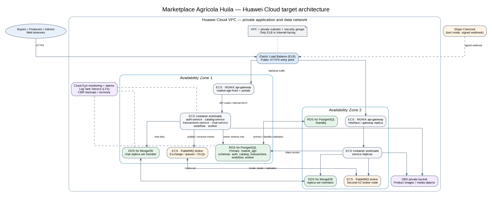

# Architecture design note — <Team name>

> Template. Replace every `<...>`, delete this note and keep the six headings exactly as they are. Between 1,200 and 2,000 words, written by you. Text left as `<...>` counts as missing.

## 1. Target architecture

| Component in the diagram | Defined in (file of your team's -docs) |
|---|---|
| `market-agri-front` and domain portals | `05-architecture/overview.md`; `05-architecture/decisions/records/ADR-021-frontend-react-module-federation.md` |
| NGINX `api-gateway` | `05-architecture/overview.md`; `05-architecture/deployment.md`; `05-architecture/decisions/records/ADR-017-api-gateway-nginx.md` |
| `auth`, `catalog`, `transactions` and `chat` services | `05-architecture/overview.md`; `05-architecture/decisions/records/ADR-007-backend-stack-split.md` |
| `workflow` and `worker` services | `05-architecture/overview.md`; `05-architecture/decisions/records/ADR-015-checkout-saga.md` |
| PostgreSQL 16 database `market_agri` and owner schemas | `06-data/README.md`; `06-data/models.md`; `05-architecture/decisions/records/ADR-010-data-isolation.md` |
| MongoDB 7 database `chat` | `06-data/README.md`; `06-data/models.md`; `05-architecture/decisions/records/ADR-010-data-isolation.md` |
| RabbitMQ exchanges, queues and dead-letter queues | `05-architecture/decisions/records/ADR-004-message-broker.md`; `05-architecture/decisions/records/ADR-014-event-delivery-outbox.md` |
| Product image objects (`photo_url`) | `06-data/data-dictionary.md`; `06-data/README.md` |
| VPC, subnets and network boundaries | `05-architecture/deployment.md`; `05-architecture/security-threat-model.md` |
| Structured logs and request correlation | `05-architecture/cross-cutting.md`; `05-architecture/overview.md` |

## 2. Five principles

| Principle | Current weakness | Evidence in -docs | Design decision | Huawei Cloud service |
|---|---|---|---|---|
| Reliability | The current platform runs through Docker Compose on team members' computers. A host failure can interrupt the gateway, application services and data stores. The single PostgreSQL instance is also a shared failure domain for five data owners. | `05-architecture/deployment.md` sections 1, 4 and 6; `05-architecture/overview.md` section 8 (AT-001); `06-data/README.md` | Distribute gateway and stateless application instances across two AZs and place the PostgreSQL primary and standby in separate AZs. Use a multi-AZ DDS replica-set deployment for chat. Keep backup and restore procedures in addition to, not instead of, high availability. | ELB, ECS, RDS for PostgreSQL, DDS, CBR |
| Security | The documented environments use HTTP, and TLS at the gateway is deferred. Environment secrets are supplied through environment files; the documentation states that there is no cloud secret manager in the MVP. | `05-architecture/deployment.md` sections 5 and 6; `05-architecture/security-threat-model.md`; `05-architecture/cross-cutting.md` section 1 | Expose only ELB to the Internet. Place gateway backends, services, databases and RabbitMQ in private subnets; restrict allowed paths with security groups; enable HTTPS at the public entry point; and use IAM to control administration of cloud resources. Preserve local RS256 JWT validation in each service. | VPC, security groups, ELB, IAM |
| Performance efficiency | The services are designed to be stateless, but the current deployment has no cloud load balancer or autoscaling. The team has not documented measured cloud traffic or a performance baseline. | `05-architecture/overview.md` section 5 (P3); `05-architecture/deployment.md` sections 4 and 6; `05-architecture/overview.md` section 8 | Use ELB to distribute requests across multiple gateway instances and deploy stateless application replicas across AZs. Begin with right-sized ECS instances and use Cloud Eye measurements before increasing capacity or introducing a cache. Do not add a cache until a measured read bottleneck justifies it. | ELB, ECS, Cloud Eye |
| Cost | The project is an academic MVP with no cloud infrastructure budget and no measured production workload. A multi-AZ deployment and managed databases introduce recurring charges that do not exist in the local Docker Compose setup. | `05-architecture/deployment.md` sections 1 and 6; `05-architecture/overview.md` section 8; `06-data/README.md` | Start with right-sized ECS and database specifications, select capacity according to measured demand, and review resource utilization before scaling. Keep optional resources such as a cache out of the initial deployment unless measurements justify their cost. | ECS, RDS, DDS, Cloud Eye |
| Operations | The project emits structured JSON logs to stdout, collected through Docker Compose. It has no centralized log platform, metrics/alerting stack or defined database recovery objectives in the current MVP. | `05-architecture/cross-cutting.md` sections 2, 3 and 5; `05-architecture/deployment.md` sections 4 and 6; `05-architecture/overview.md` section 5 (P5) | Centralize application and infrastructure logs, retain the `correlationId` across requests and events, and configure alarms for infrastructure health and resource saturation. Define and test database backup and restore procedures as part of operations. | Log Tank Service (LTS), Cloud Eye, CBR |

## 3. Scalability

| Service | Scaling metric | Threshold (number and unit) | Min instances | Max instances |
|---|---|---|---|---|
| <service 1> | <...> | <...> | <n> | <n> |
| <service 2> | <...> | <...> | <n> | <n> |

## 4. Disaster recovery

- Critical data store: <...>
- RTO: <minutes> minutes
- RPO: <minutes> minutes
- DR pattern (chapter 11): <...>
- Why the pattern meets those numbers: <two sentences>

## 5. Automated deployment

| Stage | Trigger | Tool or service | File in your team's repositories |
|---|---|---|---|
| Build | <...> | <...> | <path> |
| Test | <...> | <...> | <path> |
| Image | <...> | <...> | <path> |
| Deploy to qa | <...> | <...> | <path> |
| Deploy to production | <...> | <...> | <path> |
| Rollback | <...> | <...> | <path> |

## 6. Decisions

- [ADR-C3-01](ADR-C3-01.md): <decision>
- [ADR-C3-02](ADR-C3-02.md): <decision>
